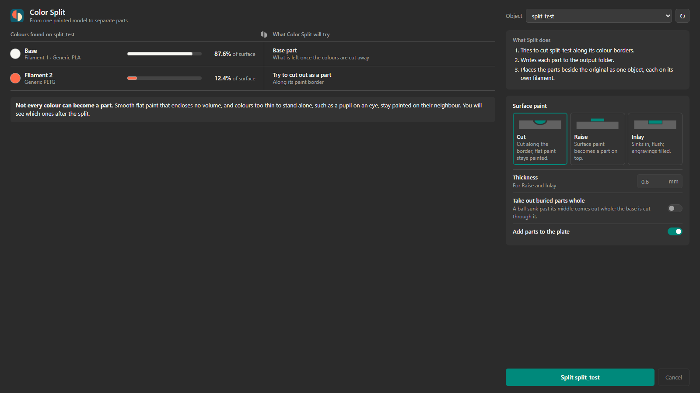
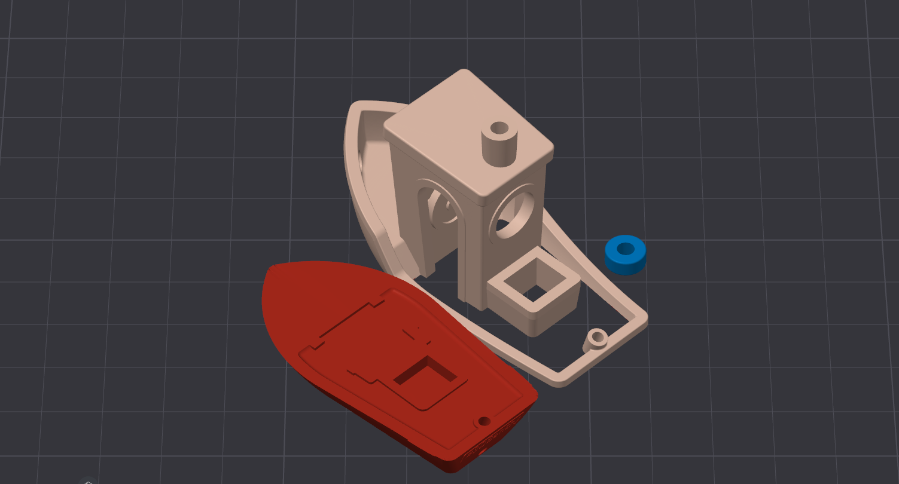

<p align="center"></p>

# Color Split

An OrcaSlicer 2.5 plugin that turns a color-painted model into separate printable parts, one
per color. You can print each color on its own and glue or press-fit the parts together,
with no multi-material unit and no purge waste.





Also on [Orca Cloud](https://cloud.orcaslicer.com/app/plugins/shared-plugins/3f2d8111-07f1-446b-a91e-4dd396d5f47b).

## What it does
Paint the model with OrcaSlicer's color painting tool, open the **Color Split** tab, pick the
object and press **Split**. The parts land on the plate as one object, each part on its own
filament, unsaved: save the project to keep them, or undo.

- **Painted features come off along the edge they stand on.** A chimney on a roof, a raised
  logo or a ball on a shoulder is cut off where the model turns sharply. The cut follows the
  surface under the feature, however curved, so the parts meet on one shared surface. There
  are no depth or clearance settings to tune.
- **A shell painted on the outside** (a boat's cabin, its door and window frames left bare)
  comes off whole at its foot, inside walls and frames included. A base-color part standing
  on it (a chimney on the roof) comes off as a part of its own.
- **Paint that winds around the model** (a ball sunk into a knee) is cut along a surface
  stretched across its visible border, like a soap film. The part touches the rest only
  through that surface, so it always fits back on.
- **Touching colors** (a tower painted half red, half blue) come off the base as one piece
  and are split between the colors.
- **Separately modelled bodies painted all over** (a stripe made as a slab pushed through a
  bar) are taken as their color's part as they are.
- **Sloppy paint is fine.** Paint that spills over an edge, or stops short of it, by up to
  0.5 mm snaps to the edge. Slivers the brush missed and stray specks are cleaned up.
- **Watertight output, no crumbs.** Every part is a closed mesh. "Split to objects" in
  OrcaSlicer gives no loose fragments. Small mesh defects in the model (duplicate vertices,
  small holes) are repaired first.

### Surface paint
Painted regions that wrap a shape (a sleeve, trousers, an eye) are cut along their paint border
and the openings closed. Paint that encloses no volume (a patch on a flat face) has nothing to
cut off. For that, the tab offers, like OrcaSlicer's text tool:
- **Cut** (default): it stays on the base, and the slicer prints it in color.
- **Raise**: it becomes a part on top of the surface, the set height thick (0.2 to 5 mm).
- **Inlay**: a pocket the set depth deep, with a part that fills it flush.

With Raise or Inlay, paint inside an engraving (engraved text) fills the engraving flush.

### Take buried parts out whole (option, off)
A round part buried more than halfway, such as a ball joint, normally comes off as its
visible part. With this option on, it comes out whole instead. The base is cut in two through
it, so the ball fits between the two halves of its socket; this leaves a seam on the base.
Only spheres are recognised.

## Install
1. Download the `.whl` file from the [latest release](../../releases/latest) (or build it, see
   below).
2. In OrcaSlicer 2.5: Plugins → install from file, and pick the wheel. OrcaSlicer installs
   `numpy`, `manifold3d` and `scipy`, and asks once for permission to start a background
   thread.
3. The **Color Split** tab appears next to Prepare and Preview. You may need to restart
   OrcaSlicer.

The same split is in the Plugins menu as **Color Split**, which opens a dialog.

## Where the files go
The plugin also writes STLs (`<object>_base.stl`, `<object>_color<k>.stl`) and
`<object>_split.3mf` to its storage folder (`%APPDATA%\OrcaSlicer\orca_plugins\plugin_data\`).
The parts are added to the plate with the message OrcaSlicer itself uses to hand a file to a
running OrcaSlicer (Windows). If that is not available, the result tells you to import the
`_split.3mf` with File → Import (Ctrl+I); its path is on the clipboard.

## Command line (no OrcaSlicer needed)
```
python -m color_split project.3mf --list
python -m color_split project.3mf --object 0 --out parts [--surface paint|raise|inlay] [--thickness 0.6] [--split-joints]
```

## Limits
- Windows is the tested platform. Adding the parts to the plate automatically works on Windows
  only; elsewhere, import the `_split.3mf` by hand.
- Only color painting is read; support, seam and fuzzy-skin paint are ignored.
- A painted feature is cut where at least 90% of its border is a sharp edge (45° or more,
  measured over 1 mm, so rounded feet count). A border at least 50% sharp is cut at the foot
  of the shell it encloses; partly sharp borders (15% or more) use the film cut.
- When every edge of a painted shell is sharp, a bare frame standing proud of its wall can stay
  on the base.
- A cut that would slice through base geometry joined to the feature (something resting on
  it, a wall touching it) is not made; the summary says why.
- An unpainted patch inside a painted feature is printed in the feature's color; the summary
  says where.

## Development
```
py -V:3.12 -m venv .venv
.venv\Scripts\python -m pip install "numpy>=2.1,<3" manifold3d scipy pytest build
.venv\Scripts\python -m pytest
.venv\Scripts\python tools\build_wheel.py
```

## Licence
Color Split is free software: you can redistribute it and/or modify it under the terms of the
GNU General Public License as published by the Free Software Foundation, either version 3 of
the License, or (at your option) any later version. It is distributed in the hope that it will
be useful, but WITHOUT ANY WARRANTY; see [LICENSE](LICENSE) for details.
